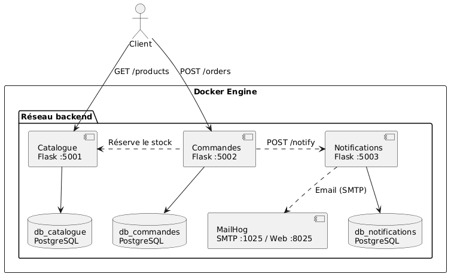

# Cloudification d'une PME e-business (microservices Docker)

Mini-projet de Cloud Computing, 3ème année E-business.
Enseignant : M. Kais LOUKIL.

Une PME tunisienne vend en ligne des produits artisanaux (cosmétiques naturels, huiles essentielles, savons). Ce dépôt contient un prototype d'architecture microservices conteneurisée, exécuté avec Docker Desktop et Docker Compose.

Rapport complet : [docs/Rapport_Mini_Projet_Cloud_Computing.pdf](docs/Rapport_Mini_Projet_Cloud_Computing.pdf)

## Architecture



| Service | Rôle | Endpoints | Port hôte | Base de données |
|---|---|---|---|---|
| Catalogue | Gestion des produits et du stock | `GET /products`, `POST /products/<id>/reserve` | 5001 | `db_catalogue` (PostgreSQL 16) |
| Commandes | Gestion des commandes | `POST /orders`, `GET /orders` | 5002 | `db_commandes` (PostgreSQL 16) |
| Notifications | Notifications et emails de confirmation | `POST /notify`, `GET /notifications` | 5003 | `db_notifications` (PostgreSQL 16) |
| MailHog | Faux serveur mail (tests) | Interface web | 8025 | aucune |

Chaque service possède son propre Dockerfile, sa propre base de données et une API REST.

### Communication entre services
Le service Commandes appelle les autres services via le réseau Docker `backend`, en utilisant le nom du service (DNS interne Docker) :
1. Commandes appelle Catalogue (`POST /products/<id>/reserve`) pour vérifier la disponibilité et réserver le stock.
2. Commandes enregistre la commande dans `db_commandes`.
3. Commandes appelle Notifications (`POST /notify`), qui enregistre la notification et envoie un email de confirmation via MailHog.

## Prérequis
- Docker Desktop (WSL 2 sous Windows)
- Git

## Lancement
```bash
git clone https://github.com/moallayasmin1/cloudify-pme-artisanale.git
cd cloudify-pme-artisanale
docker compose up -d --build
docker ps
```
Attendre 15 à 20 secondes que les bases de données démarrent. Pour arrêter : `docker compose down` (ajouter `-v` pour supprimer les données).

## Tests (PowerShell)
```powershell
# Liste des produits avec stock
curl.exe http://localhost:5001/products

# Créer une commande avec email de confirmation
'{"product_id":1,"quantity":2,"customer":"Yasmin","email":"yasmin@example.com"}' | Out-File -Encoding ascii order.json
curl.exe -X POST http://localhost:5002/orders -H "Content-Type: application/json" --data "@order.json"

# Notifications enregistrées
curl.exe http://localhost:5003/notifications

# Stock insuffisant (réponse attendue : {"error":"stock insuffisant"})
'{"product_id":2,"quantity":50,"customer":"Yasmin"}' | Out-File -Encoding ascii big.json
curl.exe -X POST http://localhost:5002/orders -H "Content-Type: application/json" --data "@big.json"
```
Les emails envoyés sont visibles sur http://localhost:8025.

## Intégration continue (GitHub Actions)
Le workflow `.github/workflows/ci.yml` se déclenche à chaque `push` et `pull_request` sur `main` ou `master`. Il construit les images Docker, démarre l'architecture, teste `GET /products` (Catalogue) et `POST /orders` (Commandes), puis arrête les conteneurs. Les exécutions sont visibles dans l'onglet **Actions** du dépôt.

## Structure du dépôt
```
.github/workflows/   workflow CI (ci.yml)
catalogue/           service Catalogue (app.py, Dockerfile, requirements.txt)
commandes/           service Commandes
notifications/       service Notifications
partie3-app/         application Flask de la Partie 3
docs/                schéma d'architecture et rapport PDF
captures/            captures d'écran des livrables
docker-compose.yml
```

## Partie 3 : application Flask simple
```bash
cd partie3-app
docker build -t mon-app .
docker run -p 8000:8000 mon-app
```
Accès : http://localhost:8000

## Fonctionnalités avancées
- PostgreSQL en conteneur (une base par service)
- Volumes persistants (`pg_catalogue`, `pg_commandes`, `pg_notifications`)
- Variables d'environnement (`DATABASE_URL`, `CATALOGUE_URL`, `NOTIFICATIONS_URL`, `SMTP_HOST`)
- Réseau Docker personnalisé (`backend`)
- Vérification du stock et envoi d'emails de confirmation
- Intégration continue avec GitHub Actions (build et tests)

## Captures d'écran
Voir le dossier `captures/` : Docker Desktop, `hello-world`, build, application, `docker ps`, communication entre microservices, email MailHog, stock insuffisant.

## Équipe
Yasmin Moalla, Khadija Abid, Islem Fakhfakh